# Expense & Invoice Platform

Paper receipts pile up in glove boxes and desk drawers, somebody types them into a spreadsheet weeks later, and month-end becomes a hunt for the slip that explains a missing amount. This platform replaces that loop. Staff photograph a receipt in a mobile app the moment they get it, a vision model reads the supplier, date, amount and line details, and accountants review, correct, approve and match those receipts to supplier invoices in a web portal. Behind the screens sits a multi-company ledger with exact minor-unit money, two-stage approval, role-based access, duplicate detection and an append-only audit log. The system has been in production since October 2026 with around 150 users (figure reported by the operator) and was validated on roughly 2,000 real receipts during testing. The source is private because it is a client's production system; this repository holds the architecture, the design decisions and sanitised screenshots. Happy to walk through the code in an interview.

  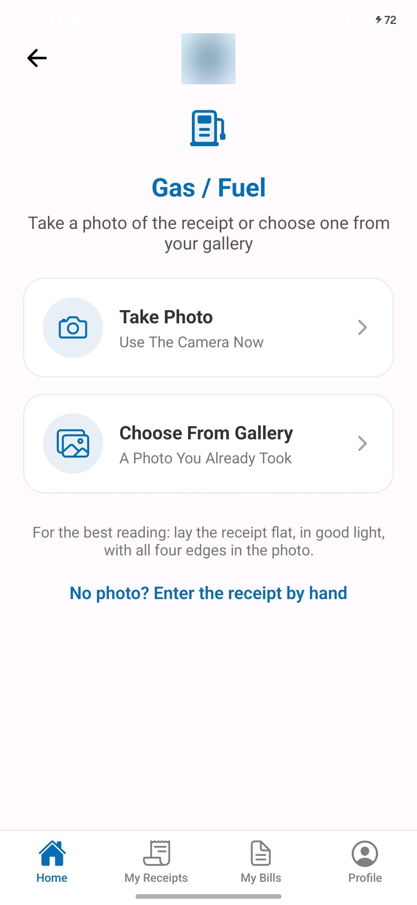

## How it works

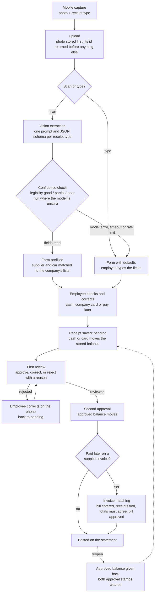

**One receipt's life.** A driver fills the tank at a fuel station, signs the station's slip instead of paying, and before leaving the forecourt opens the app, taps "Gas / Fuel" and photographs the slip. The photo is uploaded and stored on a private disk first, and its id comes back to the phone before any model is called, so a slow or failed read can never lose the receipt. The vision model is given the photo and the fuel-specific instructions and returns a fixed JSON shape: station name, date, the two odometer readings, litres, the total as printed, plus a legibility verdict. The server turns the station name into the company's supplier record and the plate into one of its cars by normalised comparison, never a fuzzy guess, and sends the phone a prefilled form.

Suppose the slip was creased and the model read the total as 28.11 instead of 20.11. The legibility verdict came back "partial", so the form opens with a banner telling the driver to check every field; the driver corrects the figure, picks "Pay later", and saves. The raw model output stays stored beside the receipt, untouched, so the correction rate can be measured later. The receipt is now pending and has moved no money, because nobody has paid anything yet. If the driver misses the error, the first reviewer catches it against the photograph on the review screen and corrects it there; the change is written to the audit log with the old and new values. The reviewer approves (state: reviewed), and the second approver, who sees only the categories assigned to them, approves again.

Two weeks later the station's monthly invoice arrives. The driver who pays it with the company card files it from the phone as a monthly bill; entering the bill is what charges the card balance, since the money has actually left. An accountant opens the bill, selects the signed slips for that supplier and period, and the "Match and Pay" button only enables when the selected receipts equal the invoice exactly. Matching ties the receipts to the bill; a second approval of the bill moves the approved balance; the statement now shows one invoice line in place of a dozen slips. If a mistake surfaces after approval, nobody edits the approved row: "Reopen" hands the approved balance back, clears both approval stamps, and the receipt passes both gates again, with every step recorded.

## Design decisions

**AI extracts, a person approves.** The model only transcribes what is printed; it is told never to compute, convert or total, and to return null rather than guess. Every field is editable before the receipt is saved, and nothing reaches the ledger without a human decision at two stages. The model's raw answer is kept unedited next to the receipt, which is what proves months later what the model said and what a person changed.

**Reversing moves instead of silent edits.** Balances change only by atomic increments inside the same transaction as the row change. A receipt can be corrected while it is still on a reviewer's desk, and the difference moves with it, audited. Once approved, the row is not edited: it is reopened, which reverses the approved balance and clears both stamps. Deletes are soft and reverse the balance the same way. A cash movement typed by an accountant is corrected by deleting it, which reverses it, and entering a new one, so the audit shows both halves.

**Multi-currency without floating point.** Money is stored as whole minor units in a 64-bit integer with its currency code beside it; a small table says how many decimal places each currency has (zero or two). One helper converts in both directions and rounds exactly once, at save time, before the integer cast. Each company has a default currency and each employee account holds one currency, so a filed receipt's currency cannot be changed. There is deliberately no exchange-rate conversion: a rate invented by software would become a figure in an accounting ledger, so when a document prints two currencies the model reports the ledger currency and otherwise leaves the amount for a person to type.

**RBAC: submitter, approver, accountant.** A role is held per company. A phone-only user files receipts and is refused at the portal door by middleware. An admin sees nothing until assigned: for each category they can be first reviewer, second approver and/or filer, and page access to the statement, transactions and suppliers is granted read-only or read-write. A company super admin needs no assignment and is the only role that can delete. A global developer role spans companies and is the only one that can read the audit log across them. One service answers every "may this person" question, where "no restriction" and "nothing assigned" are different values so the two can never be confused.

**Low confidence and failures.** The schema asks the model for a legibility verdict and for where the amount came from; "partial" or "poor" puts a check-every-field warning on the form. A provider error, a timeout or a rate limit returns the same form with defaults and a plain message, and the photo is already safe. Retries happen only for transient statuses, inside a total time budget that nests under the server's execution limit, which nests under the phone's timeout, so the attachment id always reaches the phone. Manual entry is always offered and never blocked.

**Duplicate detection flags, never blocks.** Two exact signatures are checked across every receipt type on each page: the same supplier and printed slip number (strong), and the same employee, supplier, date and amount (likely). Matches are marked on the list and listed on the receipt page for the accountant to compare; two genuinely identical fills on one day are real, so the person decides.

**Money that moves without a receipt.** Deposits to and withdrawals from an employee's cash float are typed by an accountant, are approved by definition, move both stored balances at once and carry their own reference series. The company card is never topped up because the bank bills the company, so a wrong card figure is fixed by correcting the receipt, never by typing a movement. A pay-later slip moves nothing until the supplier's invoice is entered, so the cost is counted once.

**The audit log.** Every create, update, approve, reject, reopen, match, unmatch, delete and restore writes who, which company, which table and record, the changed fields' old and new values, the channel (web, mobile or API) and a UTC timestamp. The table has no foreign keys and no soft delete, so a row can never be hidden, and a deleted user's rows still show.

**Why Laravel plus React Native.** One PHP codebase serves the portal and the JSON API with the same authentication layer, the same validation rules and the same money helper, so the phone and the web cannot disagree about what a receipt is. The mobile form is described by the server (field list, types, rules per receipt type), which means a new receipt type is a configuration change and not an app release. React Native with Expo gives one JavaScript app for both stores with native camera, gallery and secure token storage.

## What users see

### Mobile

  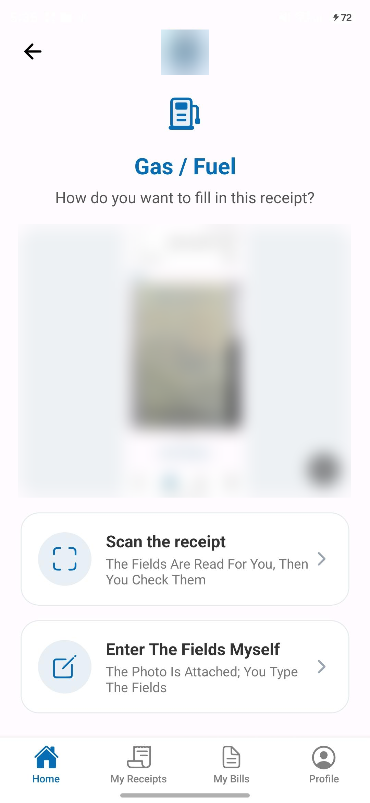
  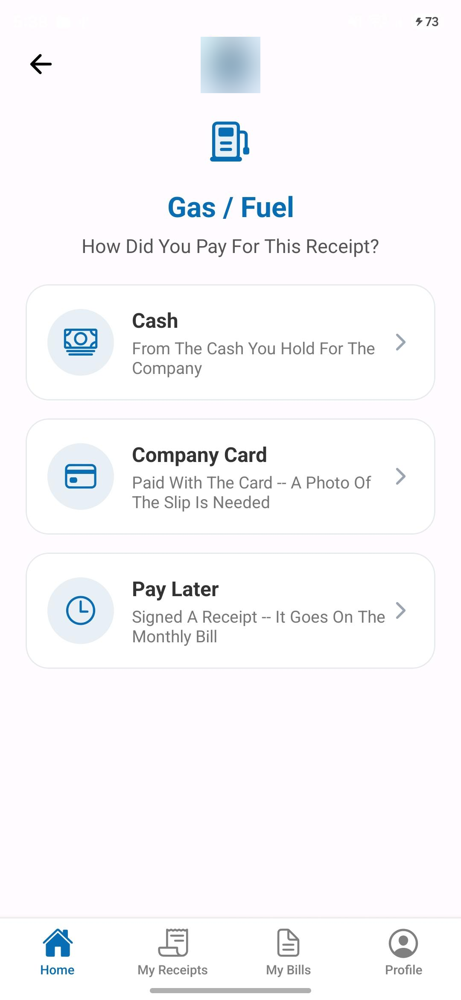
  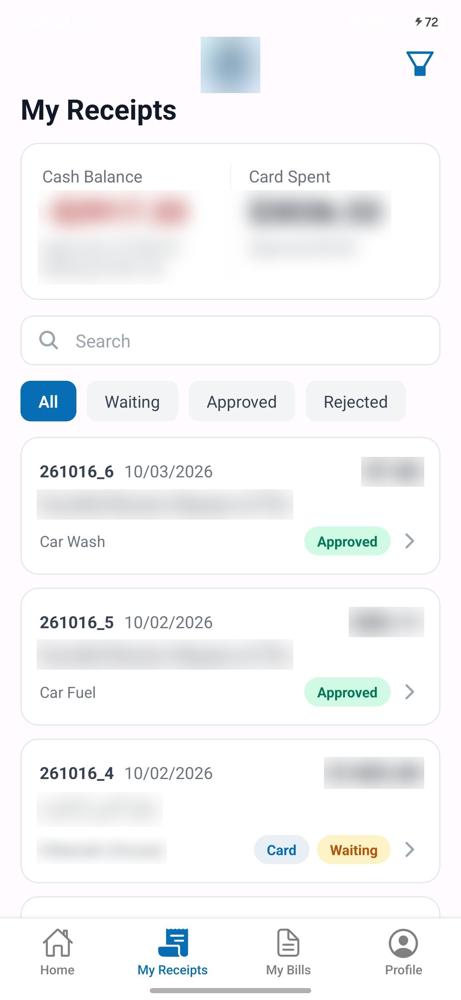

- After the photo, the employee chooses between a model read and typing the fields; the photo is attached either way.
- Saving asks how the receipt was paid, because cash and card move a balance now and a signed slip moves it only when the invoice is paid.
- The employee's own list shows both balances, the waiting / approved / rejected filter and the reason for any rejection.

### Review and approval

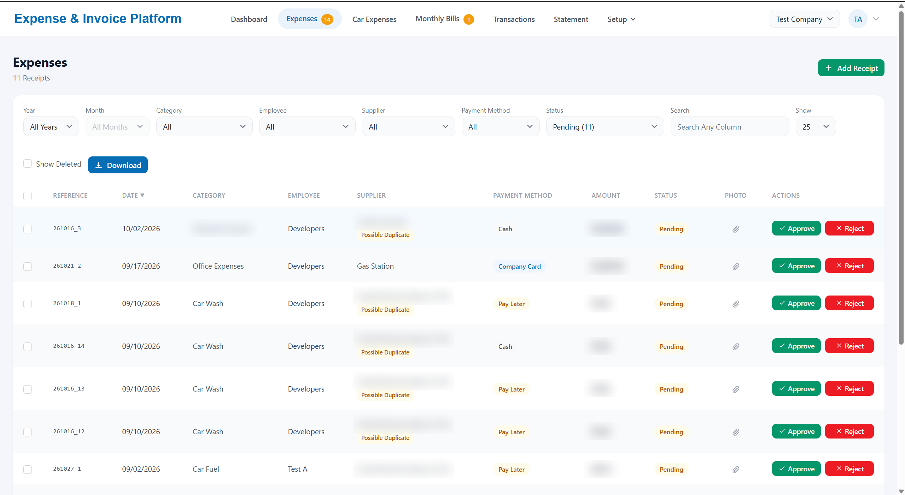
The accountant's work surface: pending receipts with duplicate flags, approve and reject in place, and every filter in the URL so a page can be shared.

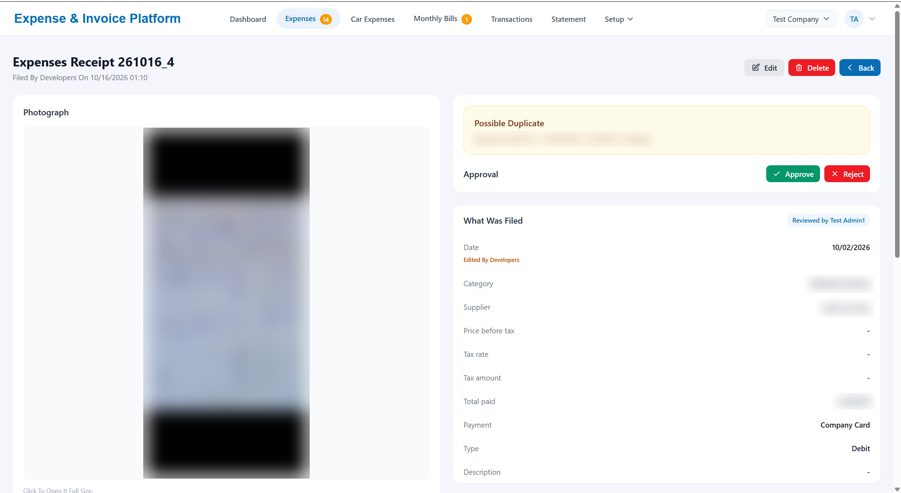
One receipt beside what was filed: a possible-duplicate banner, who edited and who reviewed, and the approve or reject decision.

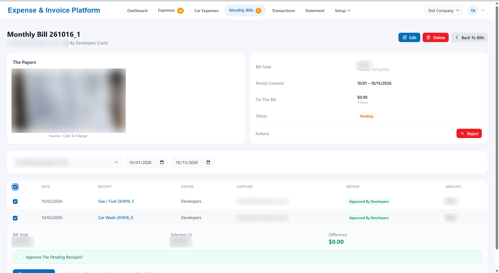
A supplier's monthly bill with the signed slips selected; matching enables only when the difference is zero.

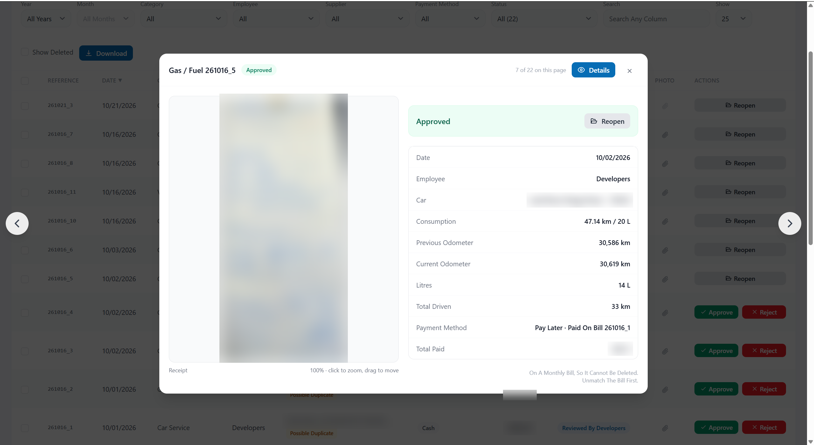
An approved receipt can only be reopened, which hands the approved balance back; a slip already on a bill must be unmatched first.

### Ledger and audit

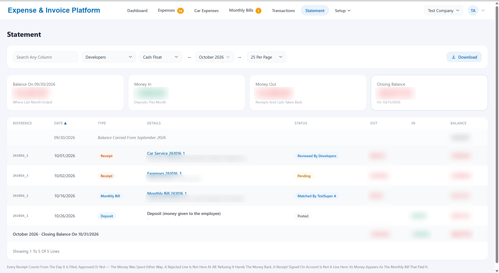
One employee's cash float for one month: opening balance, money in, receipts and withdrawals out, running balance, closing balance, downloadable as CSV.

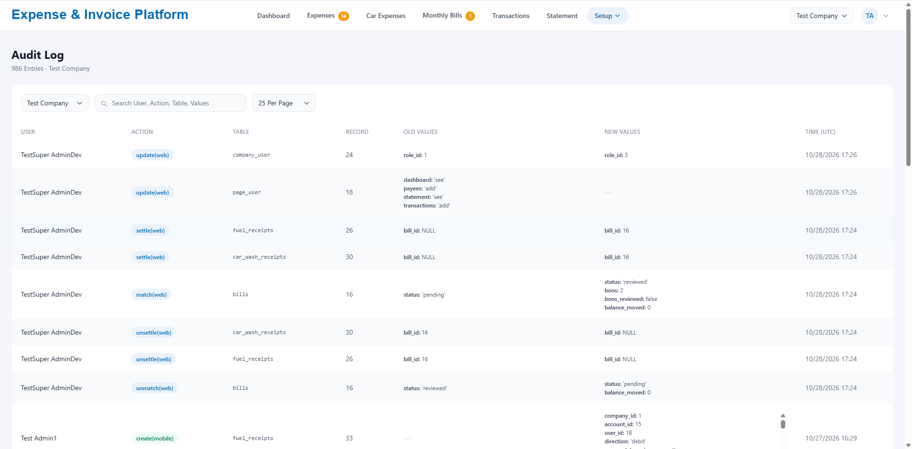
Every change with its old and new values, the acting user, the channel and the UTC time; searchable and scoped per company.

Spending this month by category, employee and car, with a twelve-month trend.

### Administration

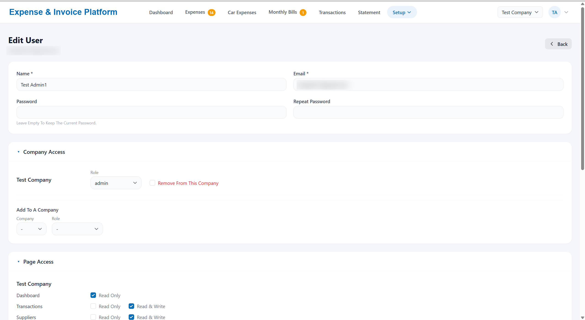
A user's role per company and read-only or read-write access per page, with category-level review, approval and filing rights further down the form.

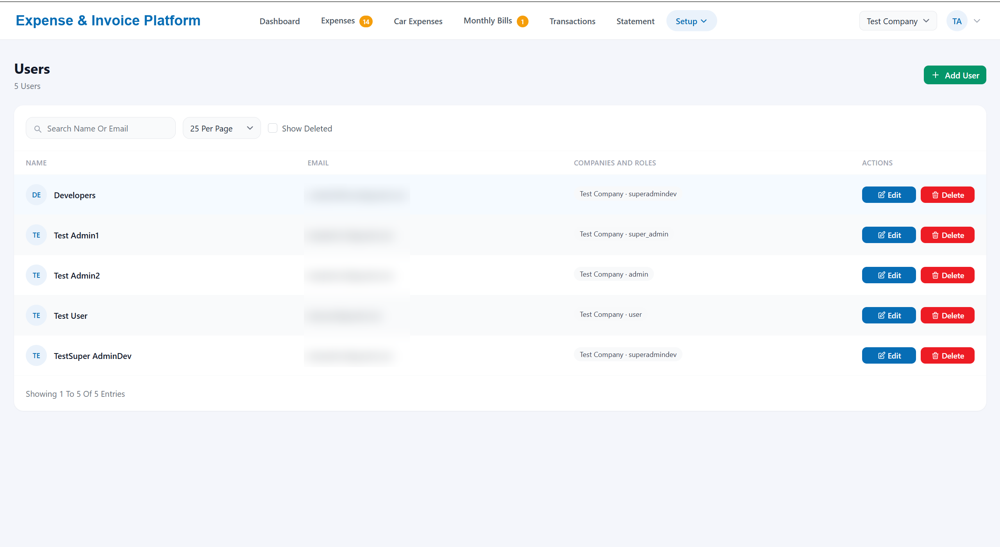
The role ladder in one list: global developer, company super admin, assigned admin, phone-only user.

## Scale and results

| Figure | How it was measured |
|---|---|
| ~150 users in production | Reported by the operator; not derivable from the repository |
| ~2,000 real receipts used to validate extraction | Reported by the developer from testing |
| About 5 seconds per model read | Timed on test receipts during development |
| Roughly $0.005 to $0.008 per receipt in model cost | Computed from the provider's token prices during testing; trimming the output schema cut the figure by about 30% |
| 60-second extraction budget, 3 attempts, 20 scans per minute per user, 10 MB per image, two images per receipt | Design limits in configuration |
| Abandoned uploads removed after 24 hours; photos of deleted receipts removed after 30 days, rows kept | Scheduled jobs |
| 58 migrations, 19 models, 12 services, 24 controllers, 97 views, 20 API endpoints, about 84 web routes, 16 mobile screens | Counted in the private repository |
| 225 logged design decisions | Counted in the project's decision log |
| Odometer unit conversion verified exact over 400,000 values | Self-check written during development |

No accuracy percentage is published because none was measured as a controlled benchmark; extraction was validated receipt by receipt against the photographs, including handwritten and bilingual tickets.

## Security and audit

- **Authentication.** Web sessions with optional two-factor authentication and passkeys; self-registration is disabled and administrators create users. The mobile app uses bearer tokens stored in the device's secure storage; deleting a user revokes every session and token at once. Login is rate-limited per email and IP; so is password reset.
- **Tenancy and roles.** Every API request names a company and the request is refused unless the caller is a member of it. Phone-only users are blocked from the portal by middleware before any controller runs. Deletion is reserved for super admins; approvers may act only on assigned categories.
- **What is logged.** Every state change, with the changed fields' old and new values, the acting user, the company, the channel and the UTC time, in an append-only table that is readable by super admins only and scoped to the company they are working in.
- **Receipt images.** Stored on a private disk under random file names, never at a public URL, with the MIME type read from the bytes rather than the file name. They are streamed only through routes that check the company and the caller's rights; an employee sees their own photos, reviewers see the photos of the categories assigned to them. Abandoned uploads are purged daily; after a receipt is deleted its photos are removed after a grace period while the record of their existence stays.
- **The model call.** The API key travels in a request header, never a query string; the model id is pinned to an exact version and the answering version is logged per call, so a change in extraction quality can be traced.

## Stack

| Layer | Components |
|---|---|
| Mobile | React Native on Expo, JavaScript, React Navigation, Material-style components, camera and gallery picker, secure token storage; built with EAS and distributed through the App Store and Play Store |
| API and portal | PHP 8.5, Laravel 13, server-rendered Blade views with Livewire and Alpine.js, Tailwind CSS, Vite; session auth for the portal and token auth for the API from one auth layer |
| Domain | One shared receipt contract across per-type tables stacked by UNION, a transition table per state machine, a single money helper, a single access-rights service |
| Data | MySQL 8 (InnoDB), minor-unit money in 64-bit integers, soft deletes by explicit flags, append-only audit table |
| AI | Google Gemini vision model over REST, one prompt and one JSON schema per receipt type, constrained JSON output |
| Reporting | Spreadsheet exports (monthly car expenses, mileage and fuel), CSV statements |
| Operations | Linux shared hosting behind Apache with PHP, cron-driven scheduler, SMTP for password reset, HTTPS, deploy by build-and-ship with migrations run on the server |

## What's in this repo

Documentation and screenshots only. There is no product code here: the extraction prompts, the JSON schemas and the matching rules are the client's, and the rest is described in [docs/ARCHITECTURE.md](docs/ARCHITECTURE.md) rather than reproduced.

## Author

Charbel P. Hajj Moussa — [GitHub](https://github.com/CHM2023) · [LinkedIn](https://www.linkedin.com/in/charbelhajjmoussa7)

Copyright (c) 2026 Charbel P. Hajj Moussa. All rights reserved. Published for portfolio and review purposes only; see [LICENSE](LICENSE).
